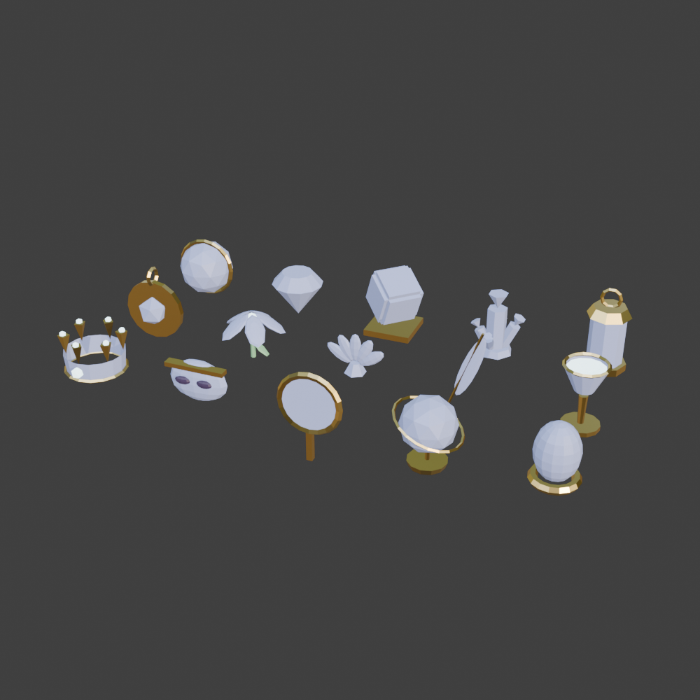

# Relikt-Modelle (Blender → Roblox)

15 Low-Poly-Formen in einem Stil, eigene Arbeit (keine Fremdlizenzen). Jede Form ist eine FBX-Datei; die 25 Relikte teilen sich die Formen und werden im Spiel eingefärbt.

| Datei | Relikte | Dreiecke |
|---|---|---|
| `orb.fbx` | Mondstein, Sonnenkiesel, Nebelkugel | 280 |
| `gem.fbx` | Sternenstaub, Traumkristall, Drachenherz | 66 |
| `cube.fbx` | Aetherwürfel | 92 |
| `shard.fbx` | Runensplitter | 174 |
| `lantern.fbx` | Waldlaterne, Mondlaterne | 184 |
| `amulet.fbx` | Moosamulett, Runenkompass | 160 |
| `bloom.fbx` | Kristallblüte | 476 |
| `shell.fbx` | Leuchtmuschel | 420 |
| `feather.fbx` | Feenflügel, Windfeder, Sternenfeder | 160 |
| `chalice.fbx` | Silberkelch | 268 |
| `crown.fbx` | Frostkrone, Aetherkrone | 336 |
| `mask.fbx` | Schattenmaske | 340 |
| `mirror.fbx` | Zauberspiegel, Zeitenspiegel | 288 |
| `globe.fbx` | Himmelsglobus | 304 |
| `egg.fbx` | Phönix-Ei | 444 |

`relics.blend` ist die Quelle (Szene „Relics“). Teile heißen `<form>.Main` (wird in Reliktfarbe gefärbt), `.Gold` (Goldmetall), `.Glow` (leuchtend), `.Dark`, `.Leaf`.

## Hochladen (du, ca. 10 Minuten)
Die Modelle landen auf deinem Konto, deshalb machst du den Upload.

1. Studio: **Home → Import 3D** (oder *File → Import 3D*).
2. Alle 15 `.fbx` aus diesem Ordner auswählen. Im Import-Dialog:
   - *Rig General → Rig Type*: **No Rig**
   - *File General → Scale Unit*: egal (das Spiel skaliert selbst)
   - *Anchored*: an
3. **Import** klicken. In *Workspace* liegen jetzt 15 Modelle (`orb`, `gem`, …).
4. In **ReplicatedStorage** einen Ordner **`RelicMeshes`** anlegen und alle 15 Modelle hineinziehen. Die Namen müssen genau den Dateinamen entsprechen (`orb`, `gem`, `cube`, …).
5. Place speichern. Ab dem nächsten Start nutzt das Spiel automatisch die neuen Modelle (Sammelbuch, Geister, Podeste). Fehlt eine Form, bleibt für sie das alte Modell.

Gib mir danach Bescheid: Ich prüfe alle 25 Relikte auf Screenshots und passe Farben oder Größe an.

## Erneut exportieren
In Blender `relics.blend` öffnen und `tools/blender/export_relics.py` ausführen (Scripting-Tab). Jede Sammlung `Relic_<form>` wird zentriert und als `<form>.fbx` exportiert.
